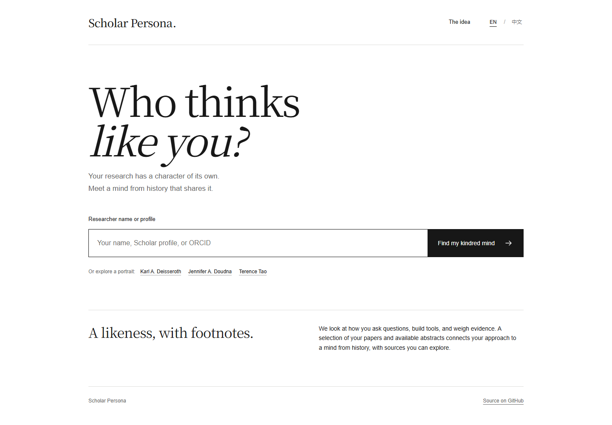

# Scholar Persona

Who thinks like you?

A small bilingual web app that connects a researcher's published work to a scientist, thinker, or maker from history. It looks for patterns in questions, methods, tools, and evidence, rather than matching research topics alone.



## The experience

Enter a name, Google Scholar URL, ORCID, or OpenAlex profile; confirm the researcher; then read an evidence-linked portrait. Each report includes a historical portrait, a short factual biography, major contributions and honours, research-method connections, and clickable paper references. English and Chinese switch together without generating a new report.

The historical match is open-ended. Wikidata, Wikipedia, Wikimedia Commons, and the Nobel Prize API resolve the chosen person's identity, image, and achievements for every new report. The three bundled examples are a showcase, not a matching catalogue.


## Run locally

Requires Node.js 22 or newer. There are no npm dependencies.

```sh
git clone https://github.com/Sprith-J/scholar-persona.git
cd scholar-persona
```

Copy `.env.example` to `.env`, set `DEEPSEEK_API_KEY`, then run:

```sh
npm start
```

Open http://127.0.0.1:4180. The key is used only by the server. `OPENALEX_API_KEY` is optional. An existing local Codex DeepSeek bridge can also be used when no API key is set, but it is not required. To explore examples without generation, set `SCHOLAR_DISABLE_MODEL=1`.

## Examples

Three selected, pre-generated public examples are available from the homepage: Karl Deisseroth, Jennifer Doudna, and Terence Tao. Reading them makes no model calls. Each includes paper references, a historical portrait and its credit.

## How a portrait is made

1. Resolve identity and ask the visitor to choose among namesakes. Scholar URLs provide an identity lead; publication records come from OpenAlex.
2. Fetch up to 30 highly cited and 30 recent records, deduplicate, then select up to 24 papers across dates and topics. Crossref and Europe PMC supplement available abstracts.
3. Request one bilingual DeepSeek interpretation, validate its paper references, and reject a self-match. There are no automatic paid retries.
4. Resolve the historical person and enrich the report with independently sourced biographical facts, honours, and a reusable portrait with attribution.
5. Save the report locally. Refresh, language changes, and downloads reuse it without a model call.

The result is an interpretation of sampled titles and abstracts, with a stated boundary to the analogy. It is not a full-text review or a measure of a researcher's ability. Coauthored work is not treated as proof of individual contribution.

## Development

```sh
npm test
```

Tests cover identity parsing, evidence references, corpus selection, Nobel identity matching, historical dates, atomic generation allowance, and the server-side provider adapter. The project uses Node's built-in test runner. Browser QA covers both languages, report navigation, downloads, evidence disclosures, portraits, and desktop/mobile layouts; no paid generation is needed for these checks.

`server.mjs` is a native Node HTTP server; `lib/` contains research retrieval, prompting, model transport, and historical enrichment; `public/` is a framework-free frontend. `scripts/export-examples.mjs` prepares only the examples explicitly listed in `public/examples.json` without calling the model.

## Local data

Private reports, model requests/responses, the local generation ledger, and credentials stay outside Git in `.data/` and `.env`. The development ledger has a 30-call cap; failed provider attempts count. Public samples omit full abstracts and private call metadata.

## Content credits

See [third-party notices](THIRD_PARTY_NOTICES.md) for font and image licences. Portrait sources and licences remain visible in each report. The project is independent of Google Scholar, OpenAlex, Wikimedia, the Nobel Foundation, and the featured researchers.
